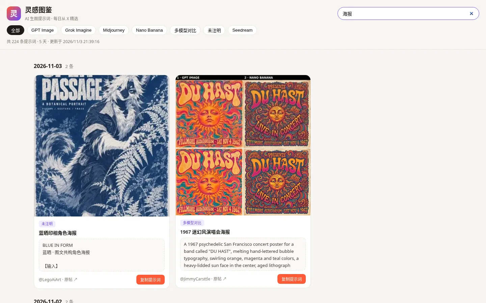
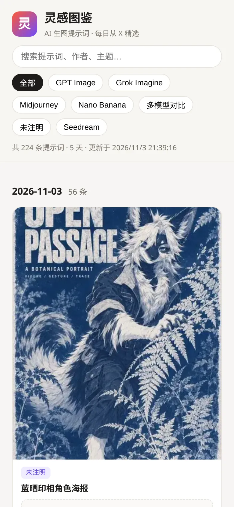
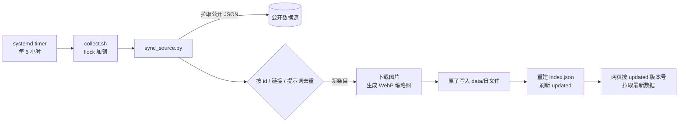

<div align="center">

# 🎨 灵感图鉴

**每日精选 AI 生图提示词 · 看图找灵感，一键复制 Prompt**

[在线访问](http://38.14.194.146/prompt/) · [功能特性](#-功能特性) · [自动更新](#-自动更新) · [部署](#-部署)


</div>

## 📖 简介

灵感图鉴是一个纯静态的 AI 生图提示词图鉴站。它从公开来源同步 Midjourney、Nano Banana、GPT Image、Grok Imagine、Seedream 等模型的优秀作品，以「效果图 + 提示词原文 + 原帖链接」的形式按日期展示，方便快速浏览、筛选和复用。

- 无需后端、无需构建，`index.html + app.js + styles.css + JSON` 即可运行
- 服务器上的定时任务每 6 小时自动同步新内容
- 网格使用本地 WebP 缩略图，浏览流畅

## ✨ 功能特性

### 瀑布流卡片 · 按日期无限滚动

每张卡片包含效果图、模型标签、标题、提示词和原帖链接；滚动到底部自动加载前一天的内容。


### 按模型筛选

顶部标签一键切换 GPT Image / Grok Imagine / Midjourney / Nano Banana / Seedream / 多模型对比 等。


### 全文搜索

支持按提示词内容、作者、主题实时搜索。



### 大图查看器

点击图片即可放大：先秒开本地图片作为占位，再在后台加载原图，加载完成后无缝替换。按 `Esc` 或点击空白处关闭。


### 一键复制 · 移动端适配

「复制提示词」按钮直接复制完整 Prompt；点击提示词区域可展开全文。手机上自动切换为单列布局。

<p align="center"></p>

## 🌐 在线访问

👉 **http://38.14.194.146/prompt/**

## 📁 项目结构

```
prompt-inspo/
├── index.html                 # 页面骨架
├── app.js                     # 渲染、筛选、搜索、无限滚动、查看器
├── styles.css                 # 样式（含移动端适配）
├── data/
│   ├── index.json             # 日期索引：每天条数、模型列表、更新时间
│   └── YYYY-MM-DD.json        # 每日条目
├── images/
│   └── YYYY-MM-DD/            # 本地图片 *.jpg 与缩略图 *.thumb.webp
├── scripts/
│   ├── sync_source.py         # 定时同步公开数据（去重 + 原子写入 + 生成缩略图）
│   ├── make_thumbs.py         # 为已有图片批量生成 WebP 缩略图
│   └── collect.py             # 可选：基于 X API 的采集（需自备 Token）
├── deploy/
│   ├── collect.sh             # 定时任务入口（flock 防重叠 + 写日志）
│   ├── prompt-inspo-collect.service
│   ├── prompt-inspo-collect.timer
│   └── nginx-prompt-images.conf
└── docs/screenshots/          # README 截图
```

## 🧾 数据格式

`data/index.json`：

```json
{
  "updated": "2026-11-03T13:39:16+00:00",
  "days": [
    { "date": "2026-11-03", "count": 56, "models": ["GPT Image", "Midjourney", "Nano Banana"] }
  ]
}
```

`data/YYYY-MM-DD.json`（数组，每项一条作品）：

```json
{
  "id": "2117392823519723522",
  "author": "LegoAiArt",
  "author_name": "LegoAiArt",
  "url": "https://x.com/LegoAiArt/status/2117392823519723522",
  "created_at": "2026-11-03T07:06:00",
  "models": ["未注明"],
  "title": "蓝晒印相角色海报",
  "note": "需提供角色参考图，长篇模板提示词。",
  "prompt": "BLUE IN FORM\n蓝晒 · 图文共构角色海报 ...",
  "images": ["images/2026-11-03/LegoAiArt_2117392823519723522_1.jpg"],
  "thumbs": ["images/2026-11-03/LegoAiArt_2117392823519723522_1.thumb.webp"],
  "remote_images": ["https://pbs.twimg.com/media/xxxx.jpg"],
  "likes": 0
}
```

| 字段 | 说明 |
|---|---|
| `images` | 本地图片，查看器的占位图 |
| `thumbs` | 网格用 WebP 缩略图（长边 ≤ 360px） |
| `remote_images` | 原图地址，查看器后台加载 |
| `url` | 原帖链接，版权归原作者 |

## 🔄 自动更新



- **频率**：systemd timer 每 6 小时运行一次（台北时间 **02:15 / 08:15 / 14:15 / 20:15**，另有最多 5 分钟随机延迟；错过会在开机后补跑）
- **去重**：按帖子 id、原帖链接、提示词文本三重去重，重复运行安全
- **原子写入**：先写临时文件再 `rename`，网页不会读到半截 JSON
- **缩略图**：新图片自动生成 `*.thumb.webp`（需要 Pillow）
- **日志**：`/var/log/prompt-inspo-collect.log`

手动执行：

```bash
python3 scripts/sync_source.py --root /srv/prompt-inspo --days 7
python3 scripts/make_thumbs.py --root /srv/prompt-inspo
```

## 💻 本地运行

```bash
git clone https://github.com/yan9651688/prompt-inspo.git
cd prompt-inspo
python3 -m http.server 8000
# 浏览器打开 http://localhost:8000/
```

同步新数据（可选，需要 Pillow 以生成缩略图）：

```bash
pip install Pillow
python3 scripts/sync_source.py
```

## 🚀 部署

1. 将仓库放到服务器，例如 `/srv/prompt-inspo`，并安装 Pillow：`apt install python3-pil`
2. 配置 nginx（挂在 `/prompt/` 子路径示例）：

```nginx
location = /prompt { return 301 /prompt/; }
location ^~ /prompt/ {
    alias /srv/prompt-inspo/;
    index index.html;
    try_files $uri $uri/ =404;

    # 数据文件不缓存，保证更新及时
    location ~* ^/prompt/data/.*\.json$ {
        add_header Cache-Control "no-cache" always;
    }
    # 图片长缓存 30 天
    location ~* ^/prompt/images/ {
        expires 30d;
        add_header Cache-Control "public, max-age=2592000" always;
    }
}
```

3. 启用定时任务：

```bash
cp deploy/prompt-inspo-collect.{service,timer} /etc/systemd/system/
systemctl daemon-reload
systemctl enable --now prompt-inspo-collect.timer
systemctl list-timers prompt-inspo-collect.timer
```

> 仓库内不包含任何密钥。`scripts/collect.py --api` 需要自行通过环境变量提供 `X_BEARER_TOKEN`，默认定时任务不使用它。

## 🛠 技术栈

| 层 | 技术 |
|---|---|
| 前端 | 原生 HTML / CSS / JavaScript，IntersectionObserver 无限滚动，`loading=lazy` + `decoding=async` |
| 数据 | 静态 JSON（按日分片 + 索引） |
| 采集 | Python 3 标准库 + Pillow（WebP 缩略图） |
| 调度 | systemd timer + flock |
| 服务 | nginx（gzip、图片 30 天缓存、数据 no-cache） |

## ©️ 版权声明

- 本站收录的图片与提示词版权均归原作者所有，每条内容均附原帖链接
- 本站仅收录公开发布的帖子，用于学习与灵感参考；如有侵权请联系删除
- 站点代码可自由参考使用
